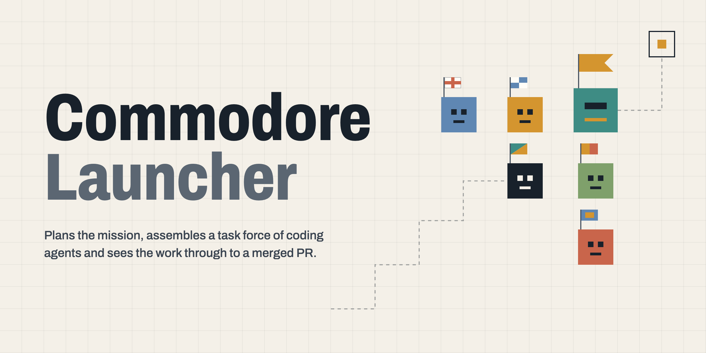

<picture>
  <source media="(prefers-color-scheme: dark)" srcset="docs/images/hero-dark.png">
  <source media="(prefers-color-scheme: light)" srcset="docs/images/hero-light.png">
  
</picture>

# Commodore Launcher

Commodore Launcher is a command-line tool that opens a GitHub issue or pull request in a harness (Claude Code, Codex CLI or GitHub Copilot CLI) with one command, and has Commodore take it from there. Commodore is a skill that plans the work and sees it through; the launcher gets the harness onto it. For each URL it:

- finds the repository on your machine (or clones it after asking) and uses the **profile** you assigned to that repository, so work and personal setups never mix;
- runs the harness right there in your terminal, in the repository's own checkout, with its invocation of Commodore on the URL (`/commodore <url>` for Claude Code), submitted at launch;
- remembers the task and its harness conversation, so opening the same issue again resumes the conversation you already have.

It works in any terminal: open a new tab or window per task, the way you like, and run `commodore open` in it.

It runs only when you call it (no server). Configuration is plain JSON under `~/.commodore-launcher/`, state is a SQLite file next to it. The design decisions are in [docs/adr/](docs/adr/); this README describes what works today.

**Profiles separate setups by configuration, not by sandboxing.** A profile decides which executable, `CLAUDE_CONFIG_DIR`, `CODEX_HOME` and environment a harness starts with, and Commodore Launcher never falls back to another profile's harness. The harness itself still runs as you and can read everything you can. See [docs/security.md](docs/security.md).

## Install

Requires Python 3.11+, [pipx](https://pipx.pypa.io), and Git. To open tasks you also need [`gh`](https://cli.github.com) (logged in) and at least one harness CLI. `commodore doctor` reports what is missing.

```bash
pipx install git+https://github.com/jbuffin/commodore-launcher.git   # from GitHub
pipx install .                                                       # from a checkout
pipx install -e .                                                    # editable, for development
pipx upgrade commodore-launcher                                      # later; config and state are kept
commodore version
```

Configuration and state live outside the installed package (`~/.commodore-launcher/`), so installing, upgrading or removing the package never touches them. If you used Agent Launcher before, the first run copies your old home once; see [Upgrading from Agent Launcher](docs/config-migrations.md#upgrading-from-agent-launcher).

### Install the skills

`pipx install` installs no skills. Two sets matter:

- **Commodore's four skills**: `commodore`, `agent-teammates`, `run-preflight` and `target-evaluation`. `open` and `doctor` check that each is installed where the harness loads skills, and refuse to start without them. Commodore Launcher assumes Commodore is installed, so install it by Commodore's own instructions; the message names where the harness looks. Claude Code loads them from `$CLAUDE_CONFIG_DIR/skills` (default `~/.claude/skills`) and enabled plugins, Codex CLI from `~/.agents/skills`, and Copilot CLI from `~/.copilot/skills` and `~/.agents/skills`. [docs/harnesses.md](docs/harnesses.md) lists every place.
- **The management skill**, `commodore-launcher`, which lets a harness change your configuration for you (add a search root, a profile). `commodore configure` depends on it.

```bash
npx skills add jbuffin/commodore-launcher --skill commodore-launcher -g    # asks which harnesses
```

`npx skills` writes only to the default directories (`~/.claude/skills`, `~/.agents/skills`) and ignores `CLAUDE_CONFIG_DIR`. If a profile uses its own config directory, copy the skill into it as well:

```bash
mkdir -p ~/.claude-work/skills && cp -R "$(commodore skill path)" ~/.claude-work/skills/
```

A copy does not follow upgrades, so copy it again after `pipx upgrade`. See [docs/management-skill.md](docs/management-skill.md).

## Quick start

```bash
commodore setup                       # profiles and harnesses, once (see "Initial setup")
npx skills add jbuffin/commodore-launcher --skill commodore-launcher -g   # the management skill (see "Install the skills")
commodore profile set ~/code/widgets work
commodore open https://github.com/acme/widgets/issues/7     # the harness runs in this terminal
```

The first `open` of a repository you have not used before asks which profile it belongs to (and offers to clone it if it is not on this machine). From then on `open <url>` for the same issue resumes the same conversation.

## Initial setup

`commodore setup` detects git, `gh` and the harnesses on your machine, shows what it found, and asks for at least one profile: its name, its harnesses, each harness's executable and configuration directory. It shows a diff of `config.json` before writing and is safe to re-run (it only adds). For scripts: `setup --answers answers.json --yes`. Details, the answers file and every setting it stores are in [docs/setup.md](docs/setup.md).

Repositories are found only under `repositories.search_roots` (two levels deep). To add a root later, for example when a work checkout lives outside your first one, re-run `setup`, pass `setup --answers` a file holding only `{"search_roots": ["~/work"]}` (roots are added, never replaced), or `commodore config edit`.

Run `commodore doctor` afterwards: it checks the configuration, tools, profiles (including that Commodore's skills are installed for each harness) and database, and says how to fix each problem.

## Creating profiles

A profile is a named identity such as `work` or `personal`. Names are yours to choose.

```bash
commodore profile add work --harness claude --env CLAUDE_CONFIG_DIR=~/.claude-work
commodore profile add personal --harness claude --executable ~/bin/claude-personal
commodore profile list
commodore profile check work                   # resolves the harness without starting it
commodore profile set <repo> work              # assign a repository (path, owner/name or URL)
commodore profile which <repo>
```

A repository has exactly one profile, chosen by you. It is stored under GitHub's immutable repository ID, so renames and transfers keep it. Unknown repositories are never assigned automatically, and changing an assignment while the repository has tasks needs an explicit decision. See [docs/profiles.md](docs/profiles.md) and [docs/security.md](docs/security.md).

## Configuring harnesses

Each profile has its own harnesses: executable (or wrapper script), arguments, environment such as `CLAUDE_CONFIG_DIR`, `CODEX_HOME` or `COPILOT_HOME`, working directory, and how resume works. Claude Code, Codex CLI and GitHub Copilot CLI are built in. If two profiles use the same harness, each must set a different configuration directory. See [docs/harnesses.md](docs/harnesses.md).

Which harness runs is chosen with `harness_selection` (`always_ask` by default, `use_default`, `ask_if_multiple`) or `open --harness NAME`. Only the repository's profile's harnesses are ever offered.

## Opening GitHub tasks

```bash
commodore open https://github.com/acme/widgets/issues/7
commodore open https://github.com/acme/widgets/pull/12
```

Commodore Launcher reads the issue or PR through `gh`, finds the task by GitHub's stable IDs (or creates it), finds or clones the repository, makes sure it has a profile, and runs the harness in that checkout, in your terminal, until you quit it. The launcher checks nothing out and changes nothing in the checkout: it creates no worktree, and Commodore takes it from there. The harness starts on its invocation of Commodore on the URL, passed on its command line and **submitted at launch**; there is nothing to configure. `configure` starts the management skill on its request text instead. Issue titles and bodies are untrusted and never reach a command or the prompt. See [docs/github-integration.md](docs/github-integration.md).

Opening the same issue again resumes its conversation: no new harness choice or prompt. If the harness is still running in another terminal, `open` says so (with its process ID) and starts nothing; switch to that terminal. `open --dry-run` shows what would run (the command, the directory, the names of the environment variables the profile sets) and starts nothing.

`open` takes a GitHub issue or PR URL only. The commands and settings of Agent Launcher that no longer exist are listed in [Upgrading from Agent Launcher](docs/config-migrations.md#upgrading-from-agent-launcher).

## Resuming sessions

```bash
commodore open <task>                  # resumes the conversation in this terminal
commodore resume <task> [--force]
```

A task has one primary session. A harness that cannot resume (Codex, a conversation that was never recorded, or one the harness never saved because nothing was submitted) starts a fresh conversation on the same session. While a task's harness runs, it holds the task's session lock, so a second `open` of that task elsewhere is refused instead of starting a second process. See [docs/sessions.md](docs/sessions.md) for what is resumable per harness.

## Troubleshooting

- `commodore doctor` first: it names what is missing and the fix. `doctor --json` is for scripts.
- `commodore --debug <command>` traces each decision to stderr and to `~/.commodore-launcher/logs/`.
- `commodore diagnostics export` writes a redacted `.tar.gz` for a bug report. Read it before sharing.
- "already running": the task's harness runs in another terminal. Switch to it, or quit it there and `open` again. If nothing is running (a process the harness started can outlive it and keep its lock), `resume <task> --force` starts it anyway.
- The harness showed a dialog (folder trust, login) before it took its prompt: answer it. The prompt was given on the harness's command line, so it is submitted once the dialog is gone.
- `--dry-run` shows what `open` would run without running it; add `--json` for scripts.
- A launch that failed before the harness started leaves the task `launch_failed`, or with a conversation the harness never saved; run `open` again and it continues without duplicates.
- Config errors name the field. `config validate` checks the file, `config migrate` upgrades an older version (with a backup), `config edit` edits a copy and saves it only if it validates. See [docs/config-migrations.md](docs/config-migrations.md).

More: [docs/diagnostics.md](docs/diagnostics.md). Before you rely on a new machine's harnesses, work through the [live validation checklist](docs/live-validation.md).

## Command reference

| Command | What it does |
| --- | --- |
| `commodore version [--json]` | Print the installed version. |
| `commodore config show [--json]` | Show the effective config: defaults overlaid with `config.json`, unknown fields included. |
| `commodore config validate [--json] [--strict]` | Check `config.json`. Errors name the field and exit 1. Unknown fields are reported as warnings; `--strict` makes them fail. |
| `commodore config migrate [--dry-run] [--yes] [--json]` | Bring `config.json` to the version this release writes: shows the plan and a diff, backs the file up to `backups/`, writes atomically, validates, restores the backup on failure. See [docs/config-migrations.md](docs/config-migrations.md). |
| `commodore config edit` | Edit `config.json` in `$VISUAL`/`$EDITOR` on a copy; saved only if it validates. See [docs/config-migrations.md](docs/config-migrations.md). |
| `commodore setup [--answers FILE --yes] [--dry-run]` | Setup wizard (also offered when you run `commodore` with no config). Shows a diff before writing; safe to re-run. See [docs/setup.md](docs/setup.md). |
| `commodore profile list\|add\|edit\|check` | Manage profiles and their harnesses. See [docs/profiles.md](docs/profiles.md) and [docs/harnesses.md](docs/harnesses.md). |
| `commodore profile set <repo> <profile>` / `profile which <repo>` | Associate a repository (path, `owner/name` or GitHub URL) with a profile, or show it. Unknown repositories are never auto-assigned. See [docs/security.md](docs/security.md). |
| `commodore tasks list\|show <id>` | List tasks, or show one with its sessions. IDs can be given as a unique prefix. |
| `commodore tasks archive <task>` / `tasks unarchive <task>` | Archive a task (metadata only: files and the session record stay; `open` refuses it) or restore it so it can be opened again. |
| `commodore open <id> [--harness A] [--dry-run [--json]]` | Reopen the task with that ID (made earlier by `open <url>`) and run its harness in this terminal. The first open picks one of the profile's harnesses (config `harness_selection`) and starts it on its Commodore invocation; later ones resume the conversation (no picker, no new prompt). A task whose harness is running elsewhere is refused (`harness_running`). A task copied from the old launcher is unarchived and started afresh; a copied task with no GitHub URL is refused. Runs in the repository's own checkout, which the launcher never changes. See [docs/sessions.md](docs/sessions.md). |
| `commodore open <issue-or-pr-url> [--harness A] [--dry-run [--json]]` | Open a GitHub issue or pull request: fetch it through `gh`, find the task by GitHub's stable IDs (or create it), find the repository checkout (offering to clone it, never silently), make sure the repository has its profile, and run the harness in this terminal on its Commodore invocation of the URL, submitted at launch. See [docs/github-integration.md](docs/github-integration.md). |
| `commodore resume <id> [--force [--yes]] [--dry-run [--json]]` | Resume the task's harness conversation in this terminal. `--force` starts it even though the session lock says it is running. See [docs/sessions.md](docs/sessions.md). |
| `commodore configure ["request"] [--repo PATH] [--profile NAME] [--harness A] [--dry-run [--json]]` | Run a harness with the bundled management skill in this terminal, as a hidden maintenance session (found again on repeat): the harness starts on the management skill and your request, submitted at launch. See [docs/management-skill.md](docs/management-skill.md). |
| `commodore skill path [--json]` | Print where the bundled `commodore-launcher` skill lives; install it with `npx skills add` (see [docs/management-skill.md](docs/management-skill.md)). |
| `commodore doctor [--json]` | Health checks with pass/warn/fail and remediation hints. Exit 1 if any check fails. |
| `commodore diagnostics export [-o FILE]` | Write a sanitised `.tar.gz` for bug reports. |
| `commodore --debug <command>` | Trace decisions to stderr and the log. Works with every command. |

See [docs/diagnostics.md](docs/diagnostics.md) for checks, logs and redaction.

## Configuration

Config lives in `~/.commodore-launcher/config.json` (set `COMMODORE_LAUNCHER_HOME` to use a different root, for example in tests). It is plain JSON you can edit by hand. A missing file is fine: defaults apply and nothing is created. Unknown fields are never dropped; `config validate` reports them. Do not put tokens or credentials in it.

```json
{
  "version": 4,
  "harness_selection": "always_ask",
  "profiles": {
    "work": {
      "default_harness": "claude",
      "harnesses": {"claude": {"executable": "claude", "env": {"CLAUDE_CONFIG_DIR": "~/.claude-work"}}}
    }
  }
}
```

Every key, its values and its default are in [docs/configuration.md](docs/configuration.md).

## Documentation

| Document | Covers |
| --- | --- |
| [docs/setup.md](docs/setup.md) | The setup wizard and the answers file |
| [docs/configuration.md](docs/configuration.md) | Every `config.json` key, files and directories |
| [docs/profiles.md](docs/profiles.md), [docs/harnesses.md](docs/harnesses.md) | Profiles, repository associations, harnesses, Claude Code, Codex, Copilot |
| [docs/github-integration.md](docs/github-integration.md) | Issues, PRs, task identity, cloning |
| [docs/sessions.md](docs/sessions.md), [docs/session-host.md](docs/session-host.md) | Reopen and resume of sessions; how a harness is run and how a task's harness is known to be running |
| [docs/management-skill.md](docs/management-skill.md) | The bundled management skill |
| [docs/security.md](docs/security.md) | Profile safety rules and what they do not protect against |
| [docs/diagnostics.md](docs/diagnostics.md), [docs/config-migrations.md](docs/config-migrations.md) | `doctor`, logs, redaction; config versions, migrations and upgrading from Agent Launcher |
| [docs/architecture.md](docs/architecture.md), [docs/development.md](docs/development.md), [docs/adr/](docs/adr/) | How the pieces fit; working on the code; decisions |
| [docs/definition-of-done.md](docs/definition-of-done.md), [docs/live-validation.md](docs/live-validation.md) | The acceptance criteria of the Commodore Launcher rewrite, each checked off with evidence; what still needs a person at a terminal |

## Development

```bash
uv sync
uv run pytest -q      # no harness, no network
```

See [docs/development.md](docs/development.md). Opt-in live tests (`COMMODORE_LAUNCHER_LIVE=1`, `COMMODORE_LAUNCHER_PACKAGING=1`) are described there and in [docs/live-validation.md](docs/live-validation.md).

## License

MIT. See [LICENSE](LICENSE).
